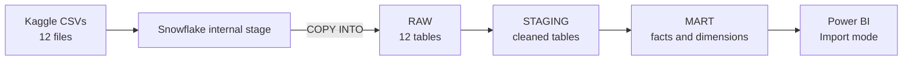
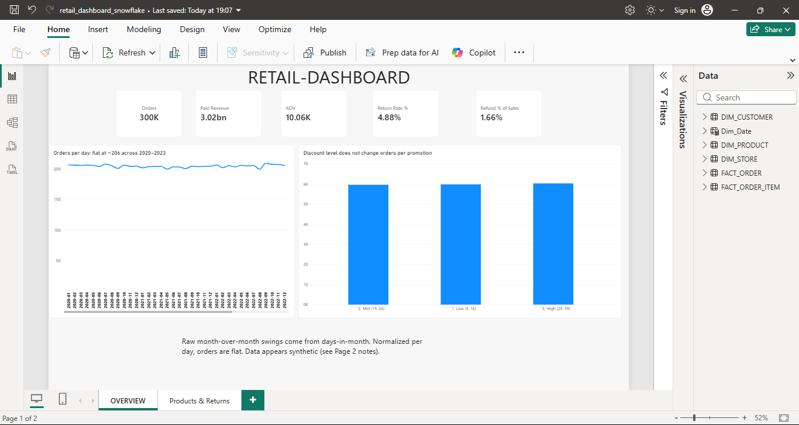

# Retail Data Warehouse: ELT, Data Audit and Dashboard (Snowflake + Power BI)
 
An end-to-end analytics project on a 12-table retail dataset (300,000 orders, 600,000 order items). I loaded the raw CSVs into Snowflake, audited data quality, modelled staging and mart layers in SQL, analysed the data, and built a two-page Power BI dashboard.
 
**Headline finding:** the dataset behaves like randomly generated data. I tested every pattern I looked at (trends, category rankings, discounts, top customers) against noise before calling it an insight, and most of them did not survive. The details are below.
 
- Author: MD Imran
- Dataset: [Retail Data Warehouse, 12 tables (Kaggle)](https://www.kaggle.com/datasets/datarspectrum/retail-data-warehouse-12-table-1m-rows-dataset)
- Tools: Snowflake (trial account), SQL, Power BI Desktop (Import mode, DAX)
## Architecture
 

 
| Layer | What it holds |
|---|---|
| RAW | The 12 CSVs loaded as-is, never edited |
| STAGING | Typed and cleaned copies, returns aggregated to item level |
| MART | `fact_order`, `fact_order_item`, `dim_customer`, `dim_product`, `dim_store` |
 
## Pipeline steps
 
1. **Setup:** XSMALL warehouse with `AUTO_SUSPEND = 60`, database `retail_db`, schemas `raw`, `staging`, `mart`.
2. **Load:** CSV file format, internal stage, `INFER_SCHEMA` to create tables, `COPY INTO` for each file.
3. **Audit:** 25 integrity checks (duplicates, nulls, orphan keys, impossible values) plus date and value profiling.
4. **Transform:** CTAS (`CREATE TABLE AS SELECT`) from raw to staging to mart.
5. **Reconcile:** totals in the mart checked against the source (sales and refunds both differ by 0).
6. **Analyse:** 9 business questions in SQL (window functions, `QUALIFY`, `RATIO_TO_REPORT`, `NTILE`).
7. **Visualise:** Power BI dashboard on the mart tables.
## Data quality findings
 
| Finding | Detail |
|---|---|
| Keys and joins | No duplicate IDs, no orphan foreign keys, every order has a payment and a shipment |
| Orders before signup | 120,020 orders (40%) are dated before the customer's signup date |
| Refunds above item value | 7,544 return rows (25%) refund more than `qty * price` |
| Prices | 599,863 of 600,000 order items differ from the product list price |
| Orders without items | 40,767 orders (13.6%) have no order items |
| Payments vs items | `payments.amount` equals the item total in only 10 of 300,000 orders |
| Promotions | Every order carries a promotion (discounts 5 to 39), so there is no "no promotion" group |
| Dates | Orders run 2020-01-01 to 2024-01-01; 2024 has one day (195 orders) and is excluded from trends |
 
**A bug I caught:** after joining returns to order items, row counts were 600,749 instead of 600,000 and sales were inflated by 4,678,939. Cause: 749 order items have more than one return row, so the join fanned out. Fix: aggregate returns to one row per order item before joining (refund summed, capped at `qty * price`). After the fix, row counts, sales and refund totals all reconcile to the source.
 
**Another one:** `INFER_SCHEMA` kept the CSV headers in lowercase, so unquoted column names failed in Snowflake (identifiers are uppercased by default). I renamed all columns to uppercase with a small loop in Snowflake Scripting.
 
## Analysis findings
 
**Revenue definition.** Payments and order items are not consistent with each other, so I kept two separate measures and never mixed them: `paid_amount` (from payments, for time, store and promotion analysis) and `gross_sales` (`qty * price`, for product, category and returns).
 
| Question | Result |
|---|---|
| Is there growth or seasonality? | No. Month-over-month swings of up to about 13% are explained by days in the month. Per day, orders sit at about 206 (range 200 to 210) and revenue at about 2.06M across 2020 to 2023 |
| Which categories dominate? | None. The top category has 3.57% of sales against an equal share of 3.33%. Among the 20 largest categories, return rates range from 4.52% to 5.26% around the overall 4.88% |
| Are there stable best-selling products? | No. Correlation of product sales between 2020-21 and 2022-23 is -0.007 across 10,000 products |
| Returns | 4.88% of items are returned. Capped refunds are 1.66% of gross sales (1.98% uncapped, of which about 17% exceeds the item value) |
| Do bigger discounts drive more orders? | No. The three discount buckets contain 17, 9 and 24 promotions, and orders per promotion are about 6,000 in every bucket. Average paid amount differs by only about 0.5% |
| Is there a VIP customer segment? | No evidence. The top 10% of customers hold 19.1% of revenue. A simulation that assigns 300,000 orders to 50,000 customers at random, with random amounts, gives 19.1% |
| Shipment status | Almost exactly one third each: shipped 33.4%, delivered 33.3%, late 33.3% |
 
**Conclusion:** the customer concentration, flat trends, equal category shares, equal shipment split and zero product-ranking stability all match what random generation would produce. I did not force a business story onto it.
 
## Dashboard
 
Two pages: **Overview** (KPIs, orders per day, orders per promotion by discount bucket) and **Products and Returns** (category sales, return rate, shipment split, store city slicer, data notes).
 
Charts that compare bar lengths start their axis at zero, and the trend chart uses orders per day instead of raw monthly totals so that month length does not create fake swings.
 


 
## What I practised in Snowflake
 
Virtual warehouses and auto-suspend, internal stages, file formats, `INFER_SCHEMA`, `COPY INTO`, identifier case rules, schema layering, CTAS, `QUALIFY`, `RESULT_SCAN`, and reconciliation checks between layers.
 
## Limitations
 
- The source looks synthetic, so findings describe this dataset, not real retail behaviour.
- Payments and order items do not reconcile, so revenue depends on which measure is used.
- The dashboard uses Import mode on a Snowflake trial account; the `.pbix` file is self-contained, but a live Snowflake connection no longer exists once the trial ends.
## Repository structure
 
```
sql/
  01_setup_and_stage.sql
  02_load_raw.sql
  03_rename_columns_uppercase.sql
  04_data_audit.sql
  05_staging_and_mart.sql
  06_fix_returns_fanout.sql
  07_analysis.sql
dashboard/
  retail_dashboard_snowflake.pbix
  retail_dashboard.pdf
  overview.png
  products_returns.png
docs/
  data_quality_notes.md
README.md
```
